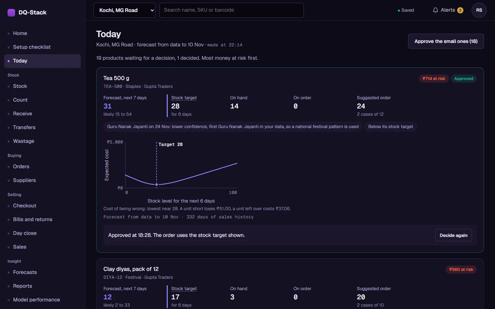
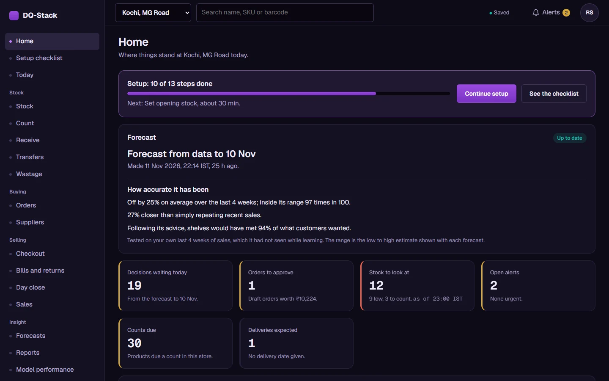
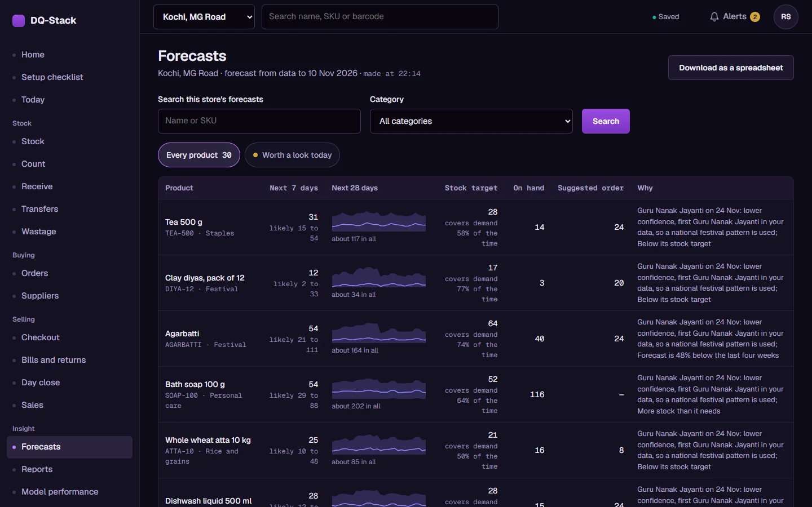
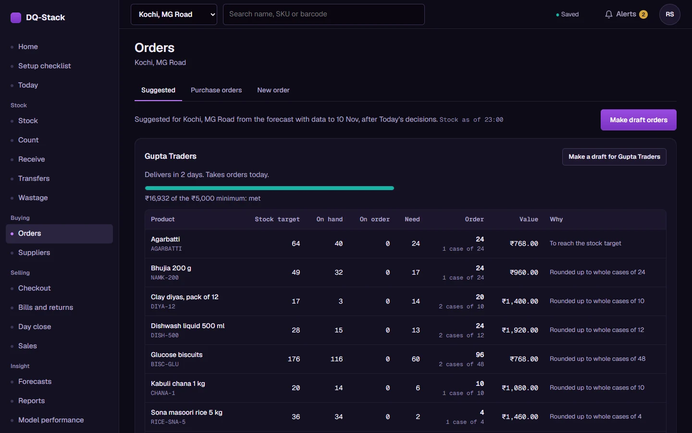
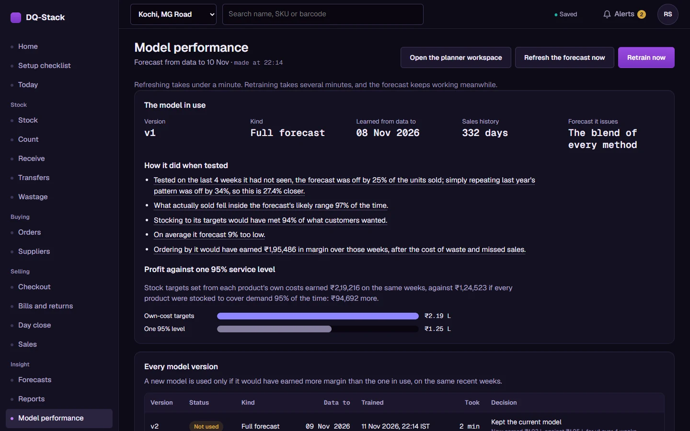
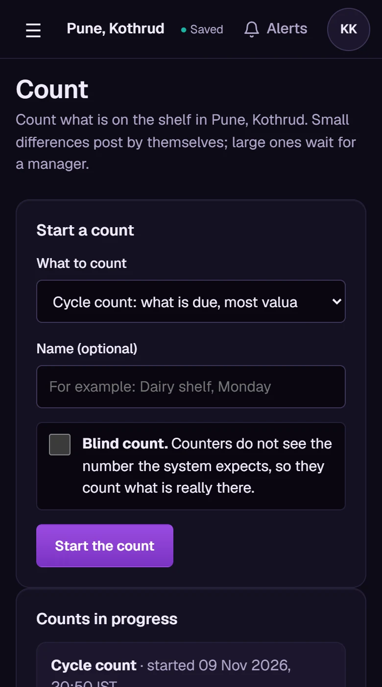

<div align="center">

# DQ-Stack

**Store operations and demand forecasting for Indian retail chains.**

Every night DQ-Stack forecasts every product in every store, sets each one's stock
target from what it actually costs to run out or to be left over, and has the
morning's orders ready for a manager to approve.

[](https://github.com/Praneet-R-S/dqstack/actions/workflows/ci.yml)




</div>

---

## Contents

- [Why it exists](#why-it-exists)
- [What it does](#what-it-does)
- [A day with DQ-Stack](#a-day-with-dq-stack)
- [Screens](#screens)
- [How the forecast works](#how-the-forecast-works)
- [Quick start](#quick-start)
- [Roles](#roles)
- [Deploying](#deploying)
- [Configuration](#configuration)
- [Security](#security)
- [Tests and CI](#tests-and-ci)
- [Project layout](#project-layout)
- [Before the first paying client](#before-the-first-paying-client)
- [Documentation](#documentation)

---

## Why it exists

Most stores order by habit and a single rule such as "keep 95% in stock on everything".
That rule overstocks cheap, slow, perishable items and understocks the profitable ones.
Both cost money: one in waste and cash tied up on the shelf, the other in missed sales.

DQ-Stack replaces the rule with arithmetic, product by product:

```
stock target  =  the point on the forecast's range where
                 cost of one unit short  ×  P(short)  =  cost of one unit left over  ×  P(left over)
```

A unit short costs its lost margin. A unit left over costs holding, markdown and
spoilage. So a high-margin item is stocked deep and a low-margin perishable is stocked
lean, and the screen says why. On the demo company, targets set this way earned
**₹2.19 lakh against ₹1.25 lakh** for a flat 95% rule over the same four weeks of sales.

---

## What it does

DQ-Stack is one application with several apps inside it: a back office, a till, a phone
app for the shop floor, and an operator portal. Each company's data is kept separate.

### Stores, people and setup
- **Many companies on one server.** Every query is filtered by company on the server, so asking for another company's record by id answers "not found".
- **Stores, people and seven roles**, from Owner to Cashier, each checked on the server for every action.
- **A setup checklist** that takes a new company from sign-up to its first forecast.
- **Imports from Excel or CSV**: products, stores, suppliers, prices, a festival calendar, sales history, daily sales files and opening stock.
  - Every row is checked first. Uploading the same file again changes nothing, and any import can be undone.

### Stock
- **An append-only stock ledger.** On-hand stock is always the sum of its movements. Database triggers stop the history from being rewritten, even by the application itself.
- **Counting.**
  - Cycle counts pick what is due, most valuable first. Blind counts hide the expected number.
  - Small differences post by themselves; large ones wait for a manager.
  - When two people count the same product, their counts are compared with each other, not with the system figure.
- **Receiving** against purchase orders. A partial delivery leaves the order open.
- **Transfers** between stores, **wastage** with reasons, and expiry tracking by batch.
- **Works offline.** Counts, deliveries and bills are saved on the device and sent once, in order, when the connection returns.

### Selling
- **Checkout**, a till in the browser.
  - Scan with a barcode scanner or the phone's camera, or search by name.
  - Hold and recall bills, add a misc item, void lines.
  - Take payment in cash, UPI or card, with GST worked out on the receipt.
- **Bills and returns**: refunds, plus exchanges as a single transaction.
- **My shift** shows a cashier their own takings. **Day close** reconciles the drawer.
- **A POS API** for existing tills, with API keys per store. Each bill is stored once even if it is sent twice.
- **A nightly SFTP file drop** for stores that export a sales file instead.

### Forecasting and ordering
- **The Today screen** lists only the forecasts worth a human look, most money at risk first.
  - Each one shows the forecast, its likely range, the stock target and the cost curve behind it.
  - Approve, change or skip each one, or approve all the small ones in one click.
- **Suggested orders** grouped by supplier.
  - They follow the supplier's lead time, order days, minimum order value and case size.
  - They become draft purchase orders, are approved, and are sent by email or WhatsApp.
- **The Forecasts screen** lists every product's forecast and range for the next 28 days, with a spreadsheet download.
- **Model performance**, in plain words: how far off the forecast has been and how often sales fell inside its range.
  - It also shows what ordering by the forecast would have earned.
  - A new model replaces the old one only if it would have earned more margin on the same recent weeks.
- **New stores and new products** get a first estimate after two weeks of sales.
  - They borrow from similar stores and products until they have eight weeks of their own.
- **Festivals** a company has not seen before get a national pattern, marked as lower confidence.

### Alerts and reports
- **Twenty kinds of alert**, each raised once per condition, in the app, by email or on WhatsApp.
  - They include out of stock, expiring stock, a count waiting for approval, an overdue delivery, missing sales, a failed nightly forecast and a drop in accuracy.
- **Fourteen reports**, each downloadable as Excel, PDF or CSV, or all in one workbook:
  - sales, sales by category, best and worst sellers
  - stock value, stock turn, slow and dead stock
  - shrinkage, wastage, count compliance
  - forecast accuracy, supplier performance, lost sales
  - profit comparison, and an accounting summary
- **An owner's weekly summary and monthly report**, emailed with every report attached.

### Connections
- **Tally**: export masters and GST-ready sales and purchase vouchers, and import stock items and the day book.
- **Zoho Inventory**: a read-only sync of items, invoices and sales orders, nightly or on demand.
- **WhatsApp Business and SMS** for purchase orders, alerts and receipts. When not configured, they fall back to shareable links.
- **Sign-in options**:
  - an optional one-time code after the password, by text or email
  - password reset by phone
  - Google and Microsoft sign-in for existing staff

### For store staff
- **Hindi** on every screen a cashier or store worker uses. Each person picks their own language.
- **Phone-first floor screens.** Counting, receiving, transfers and wastage are built to be used one-handed on a phone in an aisle.

### For the operator
- **A platform portal** for whoever runs the service.
  - Create companies and invite their owners.
  - Support access only through a temporary, logged, read-only grant.
  - Export and delete a company's data under India's DPDP Act, the data protection law.

---

## A day with DQ-Stack

```
 22:00  Stores close. Sales arrive all day: from Checkout, the POS API, an uploaded
        file, the SFTP drop, or Zoho.
        │
 night  The scheduler checks the data, forecasts every product in every store for
        the next 28 days, and sets each stock target.
        │       If the night's run fails, yesterday's forecast stays, with its age shown,
        │       and the Admin is alerted.
        ▼
 morning  Today:  the store manager reviews the few forecasts worth a look.
        │
        ▼
        Orders:   the purchaser turns suggestions into purchase orders, rounded to
        │         case sizes and supplier minimums, and sends them.
        ▼
        Receive:  the delivery is checked in on a phone; stock goes up in the ledger.
        │
        ▼
        Count:    a few products are counted each day, most valuable first; any
                  difference is explained or approved.
```

---

## Screens

| | |
|---|---|
|  |  |
| **Home.** Where the store stands today, and how accurate the forecast has been in plain words. | **Forecasts.** Every product's forecast with its range and the reason behind its order. |
|  |  |
| **Orders.** Suggestions grouped by supplier, rounded to whole cases, checked against the minimum. | **Model performance.** What the forecast would have earned, and why a new model was or was not used. |

<p align="center">
  <br>
  <b>Count, on a phone.</b> Small differences post by themselves; large ones wait for a manager.
</p>

---

## How the forecast works

The engine runs every night for each company, on that company's own sales.

| Stage | What it does |
|---|---|
| **0&nbsp;Check** | Declared schemas, row counts and totals. A failed check stops the run instead of training on bad data. |
| **1&nbsp;Diagnose** | Classes each product by how often and how steadily it sells, and scores the health of its data. Finds sold-out days, so a stockout is not learned as "nobody wanted it". |
| **2&nbsp;Features** | Lags, rolling figures, calendar, festivals, prices and promotions. Each is computed only from data before the forecast date, so the future cannot leak in. |
| **3&nbsp;Forecast** | Six families of methods, from classic statistical methods for slow sellers to LightGBM and a neural network for steady ones. |
| **4&nbsp;Combine** | Learns, product by product, how much to trust each method, instead of picking one winner. |
| **5&nbsp;Reconcile** | Makes store, category and company totals add up exactly. |
| **6&nbsp;Calibrate** | Checks that an "80% range" really holds 80% of outcomes, and corrects it where it does not. |
| **7&nbsp;Decide** | Turns each range into a stock target from the product's own costs. Then it simulates the orders, so the forecast is judged on the money it makes, not only on its accuracy. |

Every stage after Stage 3 works with a full range of outcomes, never a single number,
because a stock target is a decision about risk.

**Scale.** Above 20,000 product-store series a company is split by category and trained
in parallel. The first forecast trains in a few minutes; each night after that refreshes
it in seconds without retraining.

The full method, the evidence behind each choice and its known limits:
**[docs/FORECASTING.md](docs/FORECASTING.md)**.

---

## Quick start

You need **Python 3.12**. Docker is not needed to try it.

```bash
git clone https://github.com/Praneet-R-S/dqstack.git
cd dqstack
python -m venv .venv
```

Activate the environment: `.venv\Scripts\activate` on Windows, `source .venv/bin/activate` on macOS and Linux. Then:

```bash
pip install -c constraints.txt -r requirements.txt -r requirements-dev.txt
```

Make a demo company. It asks for one password for every demo account, then trains a
first forecast (a few minutes):

```bash
python -m dqstack.app.manage seed-demo --email you@example.com
```

Start the server:

```bash
python -m dqstack.app
```

Open **http://127.0.0.1:8130/app/** and sign in with the email and password you just gave.

The demo is **Sharma Supermarkets**:
- two stores: Pune runs Checkout, and Kochi uploads a daily sales file
- 30 products from two suppliers
- about 11 months of synthetic sales, with festival lifts
- a team of five, one person for each role

The team's sign-ins are written to `data/demo-login.txt`, which git ignores.

To run the nightly schedule as well:

```bash
python -m dqstack.app.worker
```

| Address | What is there |
|---|---|
| `/app/` | The application: back office, Checkout and the floor screens |
| `/platform` | The operator's portal |
| `/planner/` | The planner workspace: the forecasting engine's own evidence, for analysts |
| `/api/docs` | The API, documented and callable |
| `/` | The public website |

Development uses SQLite in `data/`. Production refuses to start on anything but PostgreSQL.

---

## Roles

Checked on the server for every request. "Own" means only in the stores a person is assigned to.

| | Owner | Admin | Store manager | Purchaser | Stock clerk | Cashier | Viewer |
|---|:-:|:-:|:-:|:-:|:-:|:-:|:-:|
| Company settings, people | ✓ | ✓ | | | | | |
| Billing | ✓ | | | | | | |
| Imports | ✓ | ✓ | own | | | | |
| Review forecasts (Today) | ✓ | ✓ | own | own | | | |
| Create orders, manage suppliers | ✓ | ✓ | | own | | | |
| Approve orders and count differences | ✓ | ✓ | own | | | | |
| Receive deliveries | ✓ | ✓ | own | own | own | | |
| Count, transfer, wastage | ✓ | ✓ | own | | own | | |
| Checkout | ✓ | ✓ | own | | | own | |
| Refunds, day close | ✓ | ✓ | own | | | | |
| Reports | ✓ | ✓ | own | own | | | own |
| Tally and Zoho connections | ✓ | ✓ | | | | | |

A cashier's account opens the till and nothing else.

---

## Deploying

One server runs everything with Docker Compose:

| Service | Job |
|---|---|
| `db` | PostgreSQL 16 |
| `migrate` | Applies database migrations on every start, then exits |
| `app` | The web application and API |
| `worker` | The scheduler: nightly forecasts, alerts, connector syncs, summaries |
| `caddy` | HTTPS with automatic certificates |
| `pitr` | Continuous backup with WAL-G: restore to any minute in the last 7 days |
| `backup` | A second, independent nightly dump, kept 30 days |
| `sftp` | Optional: the nightly sales file drop |

Run these on the server:

```bash
git clone https://github.com/Praneet-R-S/dqstack.git && cd dqstack
cp .env.example .env                        # fill in: domain, secret key, passwords, email, backups
docker compose up -d --build
docker compose run --rm app manage check    # every line should read OK
docker compose run --rm app manage create-platform-admin --email you@yourcompany.in --name "Operations"
```

To update after a push:

```bash
git pull && docker compose up -d --build
```

A server with 4 CPUs and 16 GB of memory is sized for 100 stores per company and 200
tills sending sales at once. The step-by-step guide, including backups, restores, scale,
WhatsApp, SMS, single sign-on, SFTP and the connectors, is
**[deploy/README.md](deploy/README.md)**.

---

## Configuration

All settings come from the environment (`.env`). [`.env.example`](.env.example) explains each one.

| Setting | Purpose |
|---|---|
| `DQ_ENV` | `development`, `staging` or `production` |
| `DQ_SECRET_KEY` | Signs sessions and encrypts stored connector credentials. Generate it with `python -m dqstack.app.config` |
| `DQ_DOMAIN`, `DQ_PUBLIC_URL` | Where people reach the service |
| `POSTGRES_PASSWORD`, `DQ_OWNER_PASSWORD`, `DQ_APP_PASSWORD` | Three different database passwords |
| `DQ_SMTP_*`, `DQ_MAIL_FROM` | Email for invitations, resets, alerts and orders |
| `DQ_WHATSAPP_*`, `DQ_SMS_*` | Optional messaging |
| `DQ_GOOGLE_*`, `DQ_MICROSOFT_*` | Optional single sign-on |
| `WALG_*`, `AWS_*` | Where backups go, and their encryption key |

Production refuses to start with an unsafe setting: the default secret, SQLite, cookies
without HTTPS, or an address that is not `https`. `manage check` says which one is wrong.

---

## Security

- **Passwords** are hashed with Argon2id. Five failed sign-ins lock an account for 15 minutes.
- **Sessions** expire, and only a hash of each session token is stored.
- **Every change needs a CSRF token**, and every role is checked on the server.
- **The activity log and the stock ledger are append-only**, enforced by database triggers.
  - The application connects as a role that does not own the tables, so it cannot switch the triggers off.
- **A strict Content-Security-Policy on every page**, plus security headers and rate limits on sign-in, resets and the POS API. Error pages never show a stack trace.
- **Connector credentials** are encrypted at rest. They are never sent to the browser or included in exports.
- **Backups** are encrypted before they leave the server. The restore drill runs in CI on every push.

Status against every target, with what is not yet done: **[docs/SECURITY.md](docs/SECURITY.md)**.

---

## Tests and CI

```bash
python -m pytest
```

More than 500 tests cover the engine, the application and the website. Each step of the
product specification has its own "done when" test. Some examples:
- an import of 5,000 rows with 20 bad ones imports 4,980, and uploading it again changes nothing
- on-hand stock equals the sum of 10,000 random movements
- 1,000 sales sent twice reduce stock once
- a user of one company cannot read another company's records by changing ids

GitHub Actions runs on every push:

| Job | What it proves |
|---|---|
| `tests` | The whole suite on SQLite |
| `postgres` | The application suite again on PostgreSQL 16. The migrations are applied to an empty database and checked against the models |
| `image` | The production Docker image builds and starts |
| `smoke` | The forecasting pipeline end to end, with its invariants |
| `pitr-drill` | Writes rows, kills the database, restores to a chosen time, and fails unless exactly the right rows come back |
| `scale` | 100 stores × 10,000 products and 200 tills at once. It fails on any error, or if the 95th percentile response time is over 2 seconds |

To run the application tests on PostgreSQL locally, set `DQ_APP_TESTS_ON_POSTGRES=1`
and `DQ_TEST_POSTGRES_URL`. On Windows, use `127.0.0.1` in that URL, not `localhost`.

---

## Project layout

```
dqstack/
  app/               the application server (FastAPI, SQLAlchemy 2, Alembic)
    routes/          the API, one module per area
    forecast/        runs the engine for each company: tiers, new products, festivals, sharding
    connectors/      Tally and Zoho Inventory
    imports/         spreadsheet imports: checks, repeat safety, undo
    migrations/      database revisions
    ledger.py        the append-only stock ledger
    checkout.py      the till
    ordering.py      suggested orders and purchase orders
    alerts.py        the twenty alerts
    reports.py       the fourteen reports, as Excel, PDF and CSV
    worker.py        the nightly scheduler
  pipeline.py        the forecasting engine's seven stages (diagnose.py, features.py, …)
  live.py            saves a trained model and forecasts from it nightly
webapp/              the application's front end (plain JavaScript, no build step)
ui/                  the planner workspace
deploy/              Caddy, PostgreSQL with WAL-G, backups, restores, SFTP
tests/               engine tests; tests/app/ for the application
docs/                security status, the forecasting method, a 20-page reference PDF
```

---

## Before the first paying client

These are built, but have not yet been tried in the real world:

- **A pilot in two stores for four weeks.** It is the last step of the product specification.
- **Live trials** of WhatsApp, SMS, Google and Microsoft sign-in, Zoho and TallyPrime against real accounts.
- **Reviews:**
  - the privacy notice and terms, by a lawyer
  - Checkout's receipts as GST invoices, by a chartered accountant
  - the Hindi text, by a native speaker
- **An accessibility audit** with screen readers.
- **The scale test** repeated on the real server, not only on GitHub's runners.

---

## Documentation

| Document | For |
|---|---|
| [deploy/README.md](deploy/README.md) | Running it in production, step by step |
| [docs/SECURITY.md](docs/SECURITY.md) | Security and reliability, target by target |
| [docs/FORECASTING.md](docs/FORECASTING.md) | The forecasting method and its evidence |
| [docs/DQ-Stack-Reference.pdf](docs/DQ-Stack-Reference.pdf) | A 20-page reference for the planner workspace |
| [CONTEXT.md](CONTEXT.md) | The engineering log: decisions, defects found and fixed, traps |

---

<div align="center">
<sub>Built for Indian retail: rupees, lakhs, GST, UPI, festivals, Hindi, and hosting in an Indian cloud region.</sub><br>
<sub>No licence has been chosen yet, so all rights are reserved.</sub>
</div>
